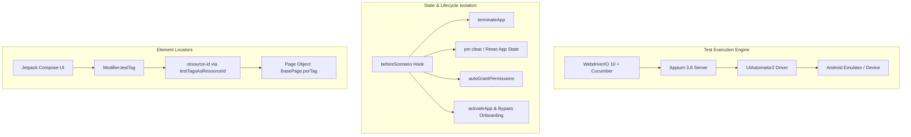

# 📱 Mobile Appium Cucumber Suite — Android & Jetpack Compose

[](https://appium.io/)
[](https://github.com/appium/appium-uiautomator2-driver)
[](https://webdriver.io/)
[](https://cucumber.io/)
[](#-ai-agent-governance-and-tooling)

> 🌐 **Language Note:** While this documentation is written in English for international review, the entire codebase, Gherkin feature files (`# language: pt`), step definitions, and `.agents/` context files are authored in **Brazilian Portuguese (pt-BR)**.

---

## ⚡ Executive Summary & Engineering ROI

Modern native mobile automation on **Kotlin Multiplatform (KMP) + Jetpack Compose** poses distinct hurdles (recomposition cycles, unstable accessibility trees, and device state leakage). This framework provides a deterministic, enterprise-ready testing pipeline.

| Metric / Capability | Standard Mobile Test Pitfall | Enterprise Engineering Solution |
| :--- | :--- | :--- |
| **Compose Element Locators** | Flaky XPath crawlers breaking on recomposition | **`testTagsAsResourceId = true`** enabling sub-10ms native `resource-id` queries |
| **State Bleed Across Tests** | Shared app cache causing cascading failures | **Hermetic cleanup** (`pm clear` + storage verification via `run-as`) |
| **Coverage Scope** | Superficial smoke tests | **198 BDD scenarios** across 9 enterprise medical CRM domains |
| **Failure Observability** | Raw stacktraces without UI context | **Automated triage**: failure screenshot + full `page-source.xml` hierarchy |
| **Live Device Inspection** | Slow manual layout inspectors | **`scripts/espiar.mjs`** lightweight CLI tree extractor |

---

## 📌 Project Overview

This repository houses an enterprise-grade mobile test automation suite for a native Android application built with **Kotlin Multiplatform (KMP) + Jetpack Compose** (MedVisit Mobile CRM).

The testing framework combines **Appium 3.8**, **UiAutomator2 Driver**, **WebdriverIO 10**, and **Cucumber (Gherkin BDD)** to execute end-to-end user journeys against a dedicated Android Virtual Device (AVD). It covers **198 automated scenarios** across 9 core functional domains:

1. **Authentication & Session:** Credential validation, token expiry, tenant resolution, input masking.
2. **Visits & Field CRM:** Check-ins with geolocation, audio note transcription, meeting scheduling, multi-tab agendas.
3. **Executive Reports:** Rep sales performance metrics, doctor engagement statistics, weekly summaries.
4. **Internal Communication:** Field chat, real-time status, announcements.
5. **Electronic Timesheet (Ponto):** Punch-in/out, GPS position capture, offline registration queues.
6. **Prescribers & Doctors:** Specialty search, medical registration numbers (CRM), address management.
7. **Secretaries & Staff:** Office staff linkage, contact details.
8. **Clinical Locations:** Clinics, hospitals, multi-address management with postal code lookups.
9. **Navigation & Global Settings:** Theme toggling, battery optimization bypass, synchronization pendencies.

---

## 🔍 Curated Code Tour (Architecture Deep Dive)

For technical recruiters and Mobile SDET Leads inspecting code quality and design patterns:

* **[tests/pages/BasePage.js](tests/pages/BasePage.js):** The foundation Page Object class that transforms Jetpack Compose `Modifier.testTag` into reliable native selectors (`porTag`), abstracting mobile gesture nuances.
* **[tests/support/appLifecycle.js](tests/support/appLifecycle.js):** Hermetic state lifecycle manager executing `terminateApp`, `pm clear`, and verifying that databases, shared preferences, and cache are zeroed out before tests begin.
* **[tests/support/apk.js](tests/support/apk.js):** Build validation utility ensuring test execution only targets verified, immutable APK packages with clean version tracking.
* **[tests/support/errorHandler.js](tests/support/errorHandler.js):** Mobile failure classifier saving screenshot evidence, page source hierarchy XML, and categorized root causes.
* **[scripts/espiar.mjs](scripts/espiar.mjs):** Live accessibility node tree inspector providing instant terminal visibility into active Android emulator layouts.

---

## 🏗️ Architecture and Mobile Patterns



### Key Engineering Decisions:
* **Jetpack Compose Native Locator Strategy:** Solves Compose element hierarchy issues by configuring `testTagsAsResourceId = true` in the application build, allowing `BasePage` to look up elements reliably using native `resource-id` selectors without flaky XPath loops.
* **Hermetic State Isolation:** Every scenario executes `terminateApp` followed by `clearApp` and runtime permission re-granting, guaranteeing zero state leakage or cached data between consecutive test runs.
* **Dual Reporting & Diagnostics:** Produces comprehensive spec reports, Allure reports, and localized HTML dashboards, backed by an automated `errorHandler.js` that logs failure screenshots, page source hierarchy dumps, and categorized root causes.
* **Recording & Visual Frame Extraction:** Includes helper scripts (`scripts/espiar.mjs`) and FFmpeg integrations to capture visual snapshots and inspect live accessibility node trees.

---

## 🧪 Feature Inventory

| Feature File | Functional Area | Scenario Count | Associated Page Objects |
| :--- | :--- | :---: | :--- |
| `1.login.feature` | Authentication & Security | 18 | `1.loginPage.js` |
| `2.visita.feature` | Visit Scheduling & Check-in | 43 | `2.visitaPage.js` |
| `3.relatorio.feature` | Executive Reports & Analytics | 25 | `3.relatorioPage.js` |
| `4.chat.feature` | Real-time Team Chat | 14 | `4.chatPage.js` |
| `5.ponto.feature` | Geolocation Timesheet (Ponto) | 10 | `5.pontoPage.js` |
| `6.prescritores.feature` | Doctor & Prescriber Directory | 27 | `6.prescritoresPage.js` |
| `7.secretarias.feature` | Office Staff Directory | 14 | `7.secretariasPage.js` |
| `8.locais.feature` | Clinic & Hospital Locations | 16 | `8.locaisPage.js` |
| `9.menu.feature` | Global Navigation & Settings | 31 | `9.menuPage.js` |
| **Total** | **Comprehensive Mobile Suite** | **198** | **Full Page Object Model** |

---

## 🚀 Getting Started

### Prerequisites
* **Node.js:** v20.x or v24.x
* **Android SDK:** Installed and configured in `$ANDROID_HOME`
* **Appium 3.x:** With `uiautomator2` driver (`npm run driver:install`)
* **AVD Emulator:** Configured with API 34+ (e.g., Pixel 6)

### Installation
```bash
git clone https://github.com/Kal9941/mobile-appium-cucumber-suite.git
cd mobile-appium-cucumber-suite
npm install
```

### Configuration (`env.json`)
```json
{
  "app": {
    "appPackage": "com.example.medvisit",
    "appActivity": "com.example.medvisit.MainActivity",
    "instalarApkNaExecucao": false,
    "apkDir": "./docs/apk"
  },
  "device": {
    "name": "Pixel_6_API_34",
    "udid": "emulator-5554",
    "platformVersion": "14.0"
  },
  "backend": {
    "baseUrl": "http://localhost:3000"
  }
}
```

### Running Tests
```bash
# Execute entire test suite
npm test

# Run a specific feature file
npm run test:spec -- tests/features/1.login.feature

# Generate HTML test report
npm run report:html
```

---

## 🤖 AI Agent Governance (`.agents/`)

Contains a complete Hot/Cold persistent context memory:
* `AGENTS.md`: Operational standards, locator heuristics, and strict `[R-*]` rules.
* `PROJECT_CONTEXT.md`: Real-time inventory of Compose `testTag` mappings.
* `ROADMAP.md`: Backlog and test execution checkpoints.
* `HISTORICO.md`: Audit log of deliveries and validated scenarios.

---

## 👤 Author
**Klismam Monteiro**
* GitHub: [@Kal9941](https://github.com/Kal9941)
* Email: [klismammonteiro1994@outlook.com](mailto:klismammonteiro1994@outlook.com)
